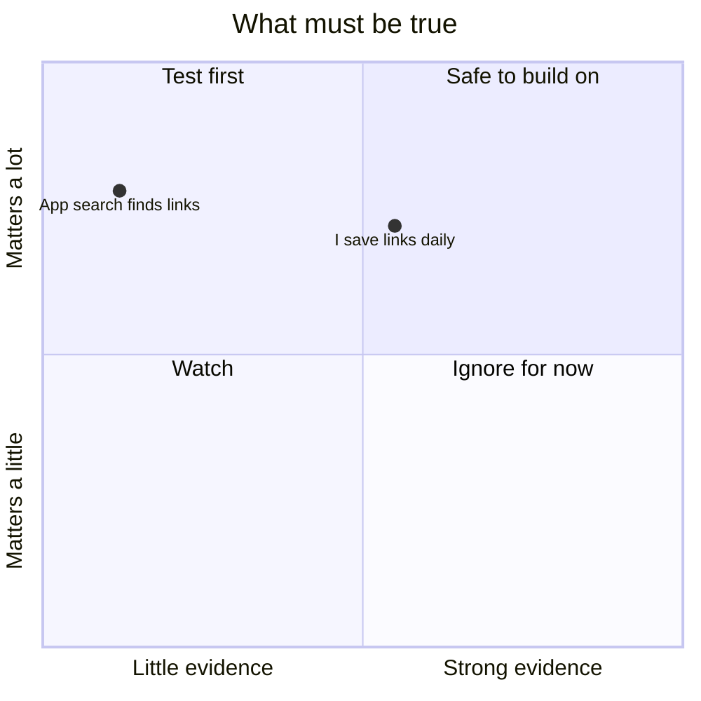
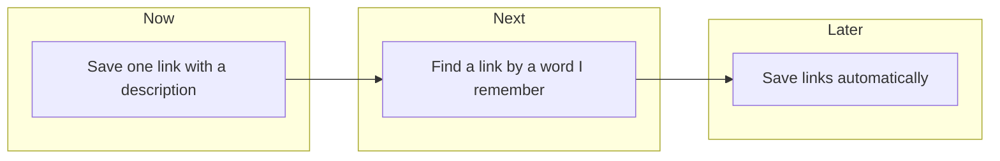

# Visuals

Maps are optional. Draw a Mermaid map only when it helps or the user asks for one. A Miro board is extra, made only when the user asks for it and Miro tools are connected. The note stays the record: a board whose decisions are not also in the note is soon forgotten.

## Mermaid maps

A map helps when it shows what the text cannot show at a glance:

- the assumption map, when the main uncertainty and `**Guesses:**` hold two or more items with Matters and Evidence;
- the plan map, when a result needs another result first.

Draw a useful map under `### Map`, or in the place the user chose. After that, update only maps that are still in the note, and add another only when the user asks. A map that the user removed stays out. Use only names and values that are in the note. Do not create a plan map when no plan exists.

Assumption map: the x axis is evidence and the y axis is how much the guess matters, from 0 to 1. Use none = 0.1, weak = 0.5, strong = 0.9, a little = 0.25 and a lot = 0.75. When several guesses share both labels, add 0.05 to x for the second, 0.10 for the third, and so on. The top-left area holds the guesses to test first.

Plan map: one box per result, grouped by place. Draw an arrow only where the note says that a result needs another result first:

Rules:

- Put labels in double quotes and keep them short. Do not use `"` inside a label.
- Do not use `kanban`: GitHub may not render it.

## Miro board

Make one board per idea, only when the user asks ("put it on Miro", "make a board").

1. Find the Miro tools. In Claude Code, search the deferred tools with ToolSearch (query `miro`). In other agents, use them only when the session already lists them.
2. If there are no Miro tools, say so in one line, give the setup line for the agent (below), and keep any Mermaid maps. Never claim a board without a URL from a tool result.
3. Do not count on fixed tool names. Miro removed its older diagram and layout tools in September 2026. Look for a tool that creates a board, and tools that create, read and update board content.
4. If the server has a format or guide tool (today `canvas_get_canvas_composer_skill`), call it first and follow it. Today board content is sent as SVG, with Mermaid inside for flowcharts.
5. Follow the user's requested layout or an existing board's layout. Otherwise choose only frames that suit the current idea and the information available. An assumption map or plan map can help when their inputs exist; neither is required.
6. Add the board URL to `### Links` in the note.
7. For a later board request on the same idea, read the board first and preserve its layout and unrelated content. Changes made on the board come into the note only through the conversation.

Each board takes about 3 Miro calls. The Miro Free plan allows 100 calls a day.

## Miro setup lines

Show only the line for the current agent:

| Agent | Setup |
| :-- | :-- |
| Claude Code | Turn on the Miro connector in claude.ai, or run `claude mcp add --transport http miro https://mcp.miro.com/` and sign in with `/mcp` |
| Codex | `codex mcp add miro --url https://mcp.miro.com/`, then `codex mcp login miro` |
| Copilot CLI | `copilot mcp add --transport http miro https://mcp.miro.com/` |
| opencode | Add `"mcp": {"miro": {"type": "remote", "url": "https://mcp.miro.com/"}}` to `opencode.json`, then run `opencode mcp auth miro` |
